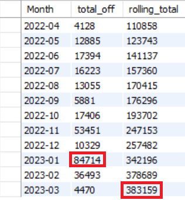
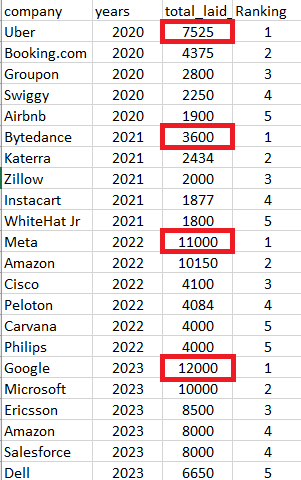

# Layoffs Exploratory Data Analysis (MySQL)

Part 2 of my layoffs SQL project. After cleaning the data in [Part 1](https://github.com/hasan914/layoffs-data-cleaning-mysql), I used MySQL to explore it and answer questions about when, where and in which industries layoffs happened between March 2020 and March 2023.

## Dataset

The cleaned table `layoffs_staging2` produced in Part 1 (global company layoffs, about 2,300 raw rows before cleaning).

There is no headcount column, so I could not calculate what share of each company was laid off. Most of the analysis relies on `total_laid_off`. `percentage_laid_off` was used mainly to find companies that laid off 100% of their staff.

## Tools

- MySQL 8.0
- MySQL Workbench

## Questions explored

- Which companies laid off the most people, and which went down to 100%?
- Which industries, countries and funding stages were hit hardest?
- How did layoffs change year by year and month by month?
- Who were the top 5 companies by layoffs in each year?

## SQL techniques used

- `GROUP BY` with `SUM()`, `MAX()` and `MIN()`
- Date functions: `YEAR()`, `SUBSTRING()`
- CTEs, including multiple CTEs chained in one query
- Rolling total with `SUM() OVER (ORDER BY ...)`
- `DENSE_RANK() OVER (PARTITION BY ... ORDER BY ...)` to rank companies within each year

## Key findings

- About **383,000** layoffs were reported between March 2020 and March 2023.
- The first three months of 2023 alone had about **125,000** layoffs, more than all of 2020 (about 81,000).
- 2021 was the quietest year. 2022, 2023 and 2020 were the highest.
- The biggest layoffs by company in a single year: Google (12,000, 2023), Meta (11,000, 2022), Amazon (10,150, 2022), Microsoft (10,000, 2023).
- Top company by year: Uber in 2020, ByteDance in 2021, Meta in 2022, Google in 2023.
- Post-IPO companies, which include Amazon and Google, accounted for over 200,000 layoffs.
- Consumer, retail and transportation were among the hardest-hit industries.
- The United States had the most layoffs by country, followed by India.

## Screenshots

| Rolling total of layoffs | Top 5 companies per year |
|--------------------------|--------------------------|
|  |  |

## How to run

1. Run the cleaning steps from [Part 1](https://github.com/hasan914/layoffs-data-cleaning-mysql) so that `layoffs_staging2` exists.
2. Run `Exploratory_Data_Analysis.sql` from top to bottom.

## Limitations

- The data only includes layoffs that were publicly reported, and some rows have missing values, so totals are a lower bound, not an exact count.
- 2023 covers only January to March.
- `percentage_laid_off` is stored as text, so converting it to a numeric type would make min/max and sorting more reliable.

## Author

Hasan Javed
